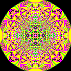
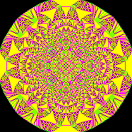

# Sandpile Simulation

A C++ implementation of the **Abelian Sandpile Model** (Bak–Tang–Wiesenfeld model).

The program simulates the evolution of a two-dimensional sandpile grid. When a cell accumulates four or more grains, it topples and distributes grains to its four orthogonal neighbors.

The simulation continues until the grid reaches a stable state or the specified iteration limit is reached.

## Features

- Two-dimensional sandpile simulation.
- Dynamic grid expansion.
- Configurable maximum number of iterations.
- Periodic BMP image generation.
- TSV input file support.
- Short and long command-line argument formats.
- Manual BMP file generation without external image libraries.
- Memory management and integer overflow checks.

## Requirements

- C++ compiler with C++17 support.
- CMake 3.15 or newer.

## Building

Clone the repository:

```bash
git clone https://github.com/NiksGH/Sandpile-Simulation.git
cd Sandpile-Simulation
```

Configure the project:

```bash
cmake -S . -B build
```

Build the executable:

```bash
cmake --build build
```

The executable is named `SandPile.exe` on Windows.

## Usage

Example:

```bash
./SandPile.exe --input input.tsv --output output.bmp --max-iter 1000 --freq 100
```

### Command-line arguments

| Short option | Long option | Description |
|---|---|---|
| `-i` | `--input` | Path to the input TSV file |
| `-o` | `--output` | Path to the output BMP file |
| `-m` | `--max-iter` | Maximum number of simulation iterations |
| `-f` | `--freq` | Frequency of BMP image generation |

Both short and long argument formats are supported.

### Simulation parameters

**Maximum iterations (`--max-iter`)**

Sets the maximum number of simulation iterations. If omitted, the simulation continues until the sandpile reaches a stable state.

**Output frequency (`--freq`)**

Controls how often BMP images are saved during the simulation.

- `--freq 0` — saves only the final state.
- `--freq N` — saves the simulation state every N iterations.

By default, only the final state is saved after the simulation finishes.

## Input Format

The input file uses the TSV (Tab-Separated Values) format.

Each line contains three values:

```text
x    y    sand_count
```

Where:

- `x` — horizontal coordinate.
- `y` — vertical coordinate.
- `sand_count` — initial number of sand grains in the cell.

Example:

```text
0    0    10
1    0    5
0    1    3
2    2    8
```

## Simulation Rules

The model follows the standard sandpile toppling rule.

Whenever a cell contains four or more grains, it distributes four grains to its orthogonal neighbors:

- One grain to the cell above.
- One grain to the cell below.
- One grain to the cell on the left.
- One grain to the cell on the right.

The process continues until the grid becomes stable or the iteration limit is reached.

The grid expands dynamically when sand spreads beyond its current boundaries.

## Output

The program generates BMP images representing the current state of the sandpile.

Each cell is assigned a color based on its number of grains:

| Sand grains | Color |
|---|---|
| 0 | Black |
| 1 | Green |
| 2 | Purple |
| 3 | Yellow |
| More than 3 | White |

Intermediate states can be saved by configuring the output frequency with `--freq`.

## Project Structure

```text
Sandpile-Simulation/
├── include/          # Header files
├── src/              # Source files
├── input/            # Input TSV files
├── CMakeLists.txt    # CMake configuration
└── README.md
```

## Implementation Details

The project is implemented in C++ and includes:

- Dynamic memory allocation and manual resource management.
- Grid expansion and coordinate handling.
- Sandpile simulation and state transitions.
- Binary BMP file generation.
- Input validation and error handling.
- Integer overflow protection.

## Visualization Examples

### Initial State


### Intermediate State



### Final State



## Repository

GitHub: https://github.com/NiksGH/Sandpile-Simulation

## License

This project is intended for educational and portfolio purposes.